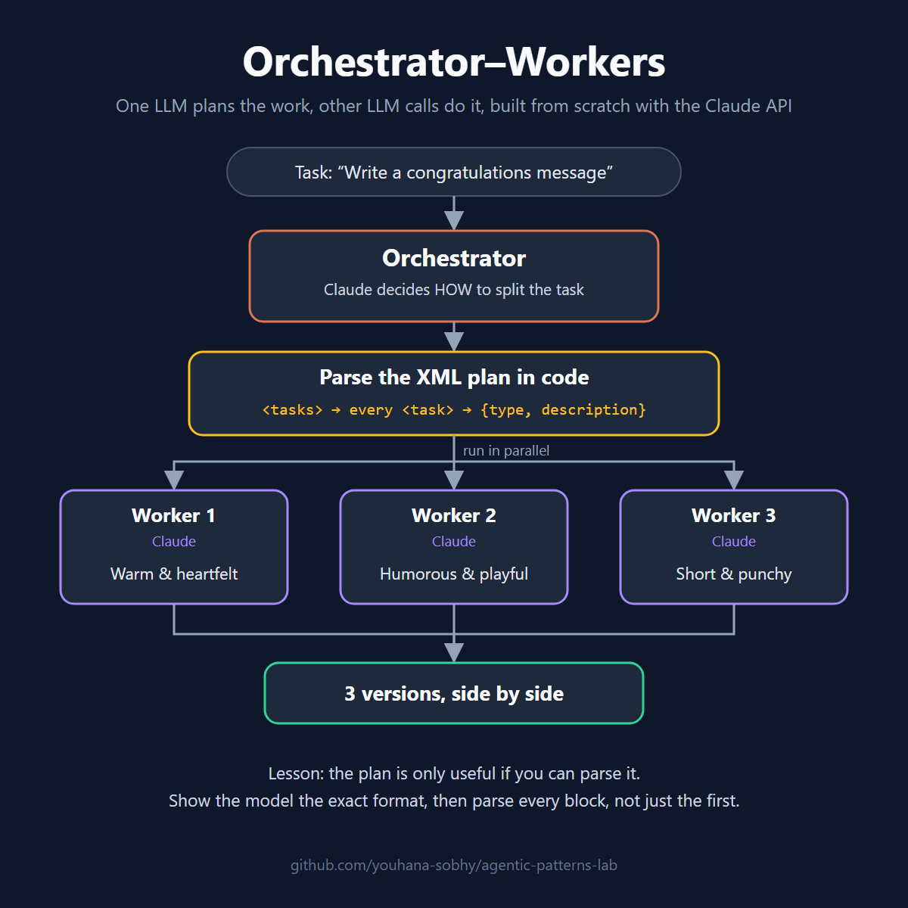

# 🧭 Orchestrator–Workers

> One LLM call plans how to split a task. Separate worker calls carry out each part, and the results come back side by side.

<p align="center">
  
</p>

## 🎯 Task

*"Write a congratulations message to your friend."*

The orchestrator decides on three clearly different approaches, such as warm and heartfelt, humorous, or short and punchy. Each worker writes the full message in its approach, so you can compare the versions.

## ⚙️ How it works

1. **Plan:** the orchestrator gets the task and returns an `<analysis>` plus a `<tasks>` list. Each `<task>` holds a `<type>` and a `<description>`.
2. **Parse:** code turns the XML into a list of `{type, description}` dicts.
3. **Delegate:** one worker call per approach. The workers don't depend on each other, so they run in parallel with `ThreadPoolExecutor`.
4. **Collect:** each worker's `<response>` is extracted and printed under its approach.

Unlike prompt chaining, the subtasks aren't fixed in code. **The model decides them at run time**, which is what makes this pattern flexible.

## 📂 Files

| File | Purpose |
|------|---------|
| [`orchestrator_workers.py`](orchestrator_workers.py) | My from-scratch implementation: plan → parse → parallel workers |
| [`util.py`](util.py) | Shared helpers: `llm_call`, `extract_xml`, `extract_all_xml` |
| [`reference_workflow.py`](reference_workflow.py) | Class-based reference implementation I studied, with my fixes noted at the top |

## 🐛 What I debugged along the way

| Symptom | Cause | Fix |
|---------|-------|-----|
| `KeyError: 'ANTHROPIC_API_KEY'` | The helper read the key before anything loaded `.env` | Call `load_dotenv()` in `util.py`, with a clear error if the key is still missing |
| Model got the literal text `{task}` | The prompt template was never `.format()`-ed | Fill the template before sending it |
| All 3 approaches came back in one `<description>` | The prompt's format example showed a single `<task>` | Show a `<tasks>` wrapper and say to repeat `<task>` once per approach |
| Printing the tasks gave one character per line | `extract_xml` returns a **string**, and looping over a string visits characters | Add `extract_all_xml`, which uses `re.findall` to return a **list** of blocks |
| Descriptions came out as `>text<` or were missing | The reference parser sliced lines at the wrong offsets and assumed one tag per line | Parse whole `<task>` blocks with regex instead of slicing lines |
| `UnicodeEncodeError` on Windows | A worker reply contained emojis, which the default console encoding can't print | Switch stdout to UTF-8 |

## ▶️ Run

From the repository root, after following the [setup steps](../../README.md#-getting-started):

```bash
python 04-workflows/Orchestrator-workers/orchestrator_workers.py
```

Change `TASK` or `NUM_APPROACHES` at the top of the script to try something else.

## 📝 Takeaways

- **The plan is only as useful as your parser.** The model copies the format you show it, so show the exact structure you want, including repeated blocks.
- **Know what your helper returns.** `re.search` gives the first match and `re.findall` gives all of them. That difference decided whether the loop worked.
- **Save a real response to test parsing.** Parsing a saved output costs nothing and makes bugs easy to reproduce.
- **Parallelize independent calls.** The workers never need each other's output, so running them at the same time cuts the wait to roughly one call.
- **Fail loudly.** If the orchestrator returns no usable tasks, the script raises an error with the raw output instead of quietly doing nothing.
