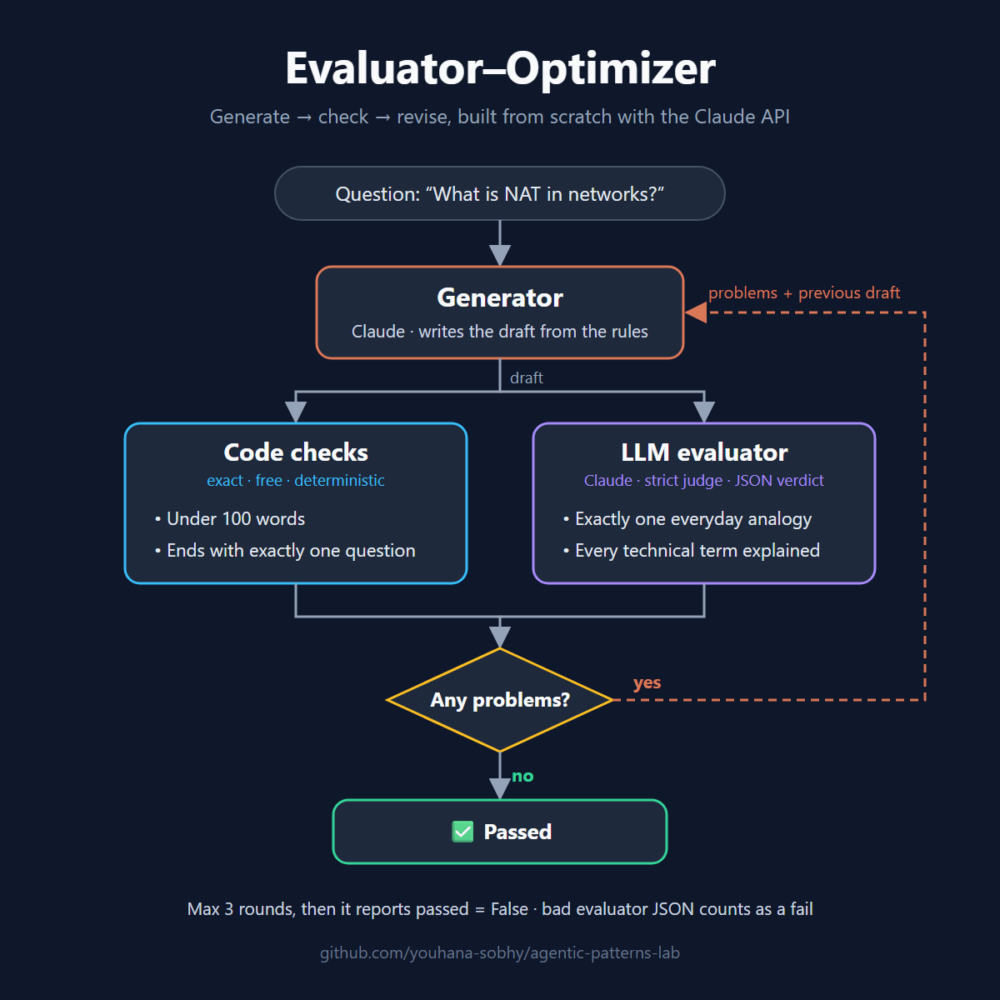

# 🔁 Evaluator–Optimizer

> One LLM writes, checkers critique, and the writer revises until every rule passes or the round limit is reached.

## 🎯 Task

Generate a beginner-friendly explanation of a technical topic (default: *"What is NAT in networks?"*) that meets four rules:

| Rule | Checked by |
|------|------------|
| Under 100 words | 🧮 Code |
| Ends with exactly one question that tests understanding | 🧮 Code |
| Contains exactly one everyday analogy | 🤖 Claude (evaluator) |
| No technical term left unexplained | 🤖 Claude (evaluator) |

## ⚙️ How it works

<p align="center">
  
</p>

1. **Generate** — Claude writes a draft from the shared list of rules.
2. **Evaluate** — code checks the rules it can measure exactly. A second Claude call, with a strict evaluator system prompt, judges the rest and returns JSON.
3. **Optimize** — any problems, plus the previous draft, are sent back to the generator for a rewrite.
4. **Stop** — when no problems remain, or after `MAX_ROUNDS`. The result says honestly whether it passed.

## 💡 Design decisions

- **Single source of truth for rules.** Each rule is defined once and reused by both the generator prompt and the checkers, so they can't drift apart.
- **Code before model.** Anything measurable (word count, question marks) is checked in code: it is cheaper, exact, and deterministic.
- **Fail closed.** Invalid or unexpected evaluator JSON, or a "fail" verdict that lists no issues, counts as a failure, never a pass.
- **Show the previous draft.** The generator sees its last attempt alongside the problems, so it revises instead of starting over.
- **Bilingual question check.** Both `?` and the Arabic `؟` are accepted.

## ▶️ Run

From the repository root, after following the [setup steps](../../README.md#-getting-started):

```bash
python 04-workflows/evaluator-optimizer/evaluator_optimizer.py
```

To try another topic, change the question passed to `run()` at the bottom of the script.

## 📝 Takeaways

- An evaluator is only as reliable as its criteria. Specific, binary rules work far better than vague ones like "make it clear".
- Splitting checks between code and an LLM keeps the loop cheap and makes failures easy to understand.
- A round limit and an honest `passed` flag stop the loop from running forever and from quietly returning a draft that failed.
